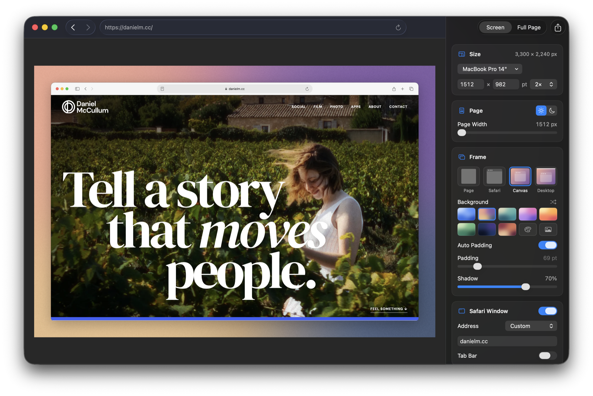

# Glamshot

A Mac app that photographs webpages at device sizes and frames them for mockups: the bare page, Safari's window, Safari on a gradient canvas, or Safari on a Mac desktop.



The page in the window is live. Sign in, close banners and scroll to the part you want, then save; the image shows what the window shows.

## Sizes

- **Mac**: MacBook Air 13" and 15", MacBook Pro 14" and 16", iMac 24", Studio Display.
- **Displays**: 1080p and 1440p.
- **iPad**: iPad mini, iPad Air 11" and 13", iPad Pro 11" and 13".
- **iPhone**: iPhone 18 Pro, 18 Pro Max, 17, Air and 17e. Pages get Safari on iPhone's user agent, so sites serve their phone layout.
- **Social**: 1080 × 1080, 1080 × 1350, 1080 × 1920 and 1920 × 1080.
- **Custom**: any width × height from 200 to 8,000 points.

The size is the saved image, whichever frame you pick: padding and the window fit inside it, and the page gets the room that's left. It saves at 1×, 2× or 3×; MacBook Pro 14" at 2× is 3024 × 1964 pixels. In Settings › Sizes you can rename, resize, reorder or delete any size, built-in or your own, and Restore Built-In Sizes puts the built-ins back.

**Page Width** lays the page out wider than the screen, up to twice its width, for pages that look cramped at the device's own size.

## Screen or full page

- **Screen** (⌘1) photographs what's in the window at the size's resolution.
- **Full Page** (⌘2) photographs the whole scrolling length as one image, up to 32,768 pixels tall. The size's width is the page's, and any frame goes around it. Before it does, Glamshot loads lazy images, finishes fade-ins and scroll animations, and keeps viewport-height sections, such as a 100vh hero, at their on-screen height.

## Frames

- **Page**: the page alone.
- **Safari**: the page in Safari's window. Mac sizes get the Mac toolbar, iPad sizes the iPad toolbar, and iPhone sizes the iPhone status bar (9:41, full battery) with the bottom address bar, full or minimized. The address shows the domain, the full URL, custom text or nothing, and there's an optional tab bar.
- **Canvas**: the page or window on one of 18 [Undertone](https://github.com/dmccullum/Undertone) gradients, a solid color or an image, with automatic or custom padding and a shadow. Shuffle rearranges a gradient's colors.
- **Desktop**: Safari on a Mac desktop with a menu bar whose app name and clock you can edit. The window fills the desktop below the menu bar, inset by the same automatic or custom padding as a canvas.

The page's Light or Dark setting sets its `prefers-color-scheme` and Safari's chrome together. Chrome is drawn at Safari's point sizes, so it stays in proportion to the page at every size and scale.

## Saving

- Save Image… (⌘S), Copy Image (⌘C), Share…, or drag the canvas into another app.
- Export Sizes… (⇧⌘E) saves every size you check to one folder.
- PNG, JPEG or HEIC. File names come from a template of tokens: Domain, Page Title, Size, Dimensions, Frame and Date.
- Copy Style and Paste Style (⌥⌘C, ⌥⌘V) copy the frame and all its settings, such as background, padding and address, between windows.
- Every change in the inspector or on the canvas can be undone.

## Pages

Type an address (⌘L), open a local `.html`, `.webarchive` or `.webloc` file (⌘O), drop a link on the window, or bring in Safari's front page (⌥⌘L), one of its open tabs, or a bookmark. Hide Elements… hides parts of a page by CSS selector, such as a cookie banner. Wait After Loading in Settings gives animations and late content up to five seconds to finish before the photo.

`glamshot://open?url=<address>` opens an http or https page in Glamshot. To send Safari's current page there, save this as a bookmark's address:

```
javascript:location.href='glamshot://open?url='+encodeURIComponent(location.href)
```

## Shortcuts and the command line

The **Take Glamshot** action in Shortcuts takes a web address, a size and Full Page, and returns the image framed with the current settings.

From Terminal:

```sh
Glamshot.app/Contents/MacOS/Glamshot --capture https://example.com out.png \
  [--size 1512x982] [--scale 2] [--full-page] [--safari] [--canvas | --desktop] [--dark]
```

## Building

Requires macOS 26 and Xcode 26. Glamshot builds against two packages that Swift Package Manager fetches from GitHub: [DMKit](https://github.com/dmccullum/DMKit), the shared components of the author's Mac apps, and [Undertone](https://github.com/dmccullum/Undertone)'s `UndertoneKit`.

```sh
swift build
swift test                                                               # layout, naming and option logic
Scripts/build-app.sh && open build/Glamshot.app                          # or double-click Build Glamshot.command
build/Glamshot.app/Contents/MacOS/Glamshot --self-test Tests/Fixtures    # photographs the fixture pages and checks pixels
```

## License

Copyright © 2026 Daniel McCullum. Glamshot is free software under the [GNU General Public License v3.0](LICENSE): you may use, change and share it, and anything you distribute that's built from it must be shared under the same license.
